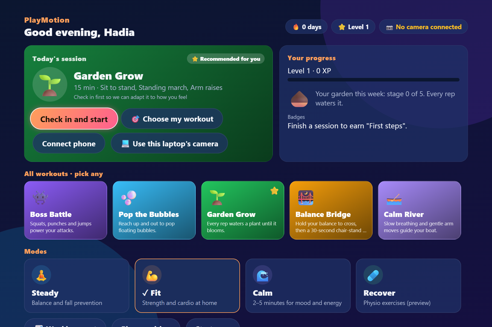
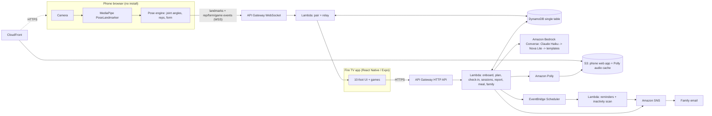

# PlayMotion

**An AI health coach that turns every workout into a game on your TV.**
Your phone becomes the camera, your Fire TV becomes the coach and the game screen. No install on the phone: scan a QR code and move.

**Try it now:** open **https://dnt0we121kyft.cloudfront.net** in Chrome (the browser plays the TV), then either scan the QR code with your phone or click **💻 Use this laptop's camera**. Stand 2–3 m back so your whole body is in view.



| Mode | For | Games |
|---|---|---|
| **Steady** | Balance and fall prevention for older adults | Balance Bridge, Garden Grow, Pop the Bubbles, 30-second chair-stand test |
| **Fit** | Weight loss, home strength and cardio | Boss Battle, Pop the Bubbles |
| **Calm** | 2–5 minute sessions for low mood, anxiety, low energy | Calm River, Garden Grow |
| **Kids** (5–12, parent-controlled) | Story-based movement games | Jungle Quest, Superhero Training, Freeze Dance, Floor Is Lava |
| **Recover** (preview) | Physio-prescribed exercises | Mock-up |

> PlayMotion is wellness coaching, not a medical device. Video never leaves the phone.

Built for the Amazon **Build, Ship, Shape** hackathon (Fire TV track + AWS Builder challenge).

## Architecture



**Privacy by design:** the camera frames are processed on the phone by MediaPipe. Only 33 landmark points and game events go over the WebSocket. Meal photos are sent to Bedrock for tips and never stored. Kids profiles store only a nickname and avatar, and the nickname is never sent to the model (it writes `{{name}}`, the server fills it in).

**Safety by design:** a rule engine builds every plan (mobility, pain areas, age, impact level), so an LLM can never put a wheelchair user into jumping jacks. Bedrock only personalises the wording. Every Bedrock and Polly call has a timeout and a template fallback, so the demo never breaks.

## AWS services (all called from code)

| Service | Used for | Code |
|---|---|---|
| API Gateway (WebSocket) | TV ↔ phone pairing by 6-digit code, real-time pose/rep/form/game relay, Move Together | [infra/src/ws/handler.mjs](infra/src/ws/handler.mjs) |
| API Gateway (HTTP API) | `/onboard` `/plan` `/checkin` `/session/complete` `/report` `/meal` `/family` `/tts` `/story` … | [infra/src/api/](infra/src/api/) |
| AWS Lambda (Node.js 22, arm64) | WebSocket relay, HTTP API, scheduled jobs | [infra/template.yaml](infra/template.yaml) |
| Amazon DynamoDB | Single table: users, plans, progress, check-ins, sessions, fall tests, family, pairing | [infra/src/lib/db.mjs](infra/src/lib/db.mjs) |
| Amazon Bedrock (Converse API) | Personal plan explanation, adaptive coaching lines, kids' story narration, weekly report, meal-photo feedback (vision) | [infra/src/lib/ai.mjs](infra/src/lib/ai.mjs) |
| Amazon Polly (neural) | Coach, calm and kids narrator voices, cached in S3 | [infra/src/lib/voice.mjs](infra/src/lib/voice.mjs) |
| Amazon EventBridge Scheduler | Per-user session + water reminders in the user's time zone, daily inactivity scan | [infra/src/lib/schedule.mjs](infra/src/lib/schedule.mjs) |
| Amazon SNS | Family updates ("Ammi finished today's session ✓"), 3-day inactivity alert, weekly report | [infra/src/lib/notify.mjs](infra/src/lib/notify.mjs) |
| Amazon S3 + CloudFront | Hosts the phone web app over HTTPS (camera needs HTTPS), serves Polly audio | [infra/template.yaml](infra/template.yaml) |

Cost: everything is on-demand / pay-per-request. Idle cost is close to $0; a day of demo rehearsals costs cents (mostly Bedrock tokens).

## Repository layout

```
apps/
  tv/          Fire TV app (fork of Amazon's react-native-multi-tv-app-sample, Expo SDK 54)
  phone/       Vite + React camera page with MediaPipe pose engine
packages/
  shared/      Exercise/game catalog + WebSocket protocol (source of truth for IDs)
  shared-ui/   TV screens, navigation, remote control (from the Amazon sample) + PlayMotion TV code in src/movewell
infra/
  template.yaml   One SAM template (us-east-1)
  src/            Lambda code: ws/, api/, jobs/, lib/, test/
scripts/       PowerShell deploy / env / smoke-test helpers
docs/          API + WebSocket protocol
```

## Setup and run (Windows, about 5 minutes once tools are installed)

Prerequisites: Node.js 22 LTS, AWS CLI v2, AWS SAM CLI, an AWS account with `aws configure` done.

```powershell
winget install OpenJS.NodeJS.LTS Amazon.AWSCLI Amazon.SAM-CLI
```

```powershell
# 1. Check which Bedrock models your account can call (prints the deploy command)
.\scripts\check-bedrock.ps1

# 2. Deploy the backend (writes apps/*/.env.local with the URLs)
.\scripts\deploy.ps1 -ModelIds "<chain printed by step 1>"

# 3. Verify
npm test                      # pure-logic unit tests, no AWS needed
.\scripts\smoke-test.ps1      # calls every HTTP endpoint
node scripts\ws-pair-test.mjs # simulated TV + phone pairing and relay
```

```powershell
# 4. Publish the phone camera page, then pair it with a pretend TV
.\scripts\deploy-phone.ps1
node scripts\fake-tv.mjs      # prints a code + link; press 1/2/3 to start sit-to-stand / arm raises
```

```powershell
# 5. Run the real TV app on the Android TV emulator (Yarn 4 workspace; see apps/tv/README.md for one-time setup)
yarn install
yarn tv:android
```

The TV and phone apps have their own run steps in [apps/tv/README.md](apps/tv/README.md) and [apps/phone/README.md](apps/phone/README.md).

Tear down after judging: `.\scripts\teardown.ps1`.

## Safety

- Saying or tapping **Stop**, or reporting pain, pauses immediately and offers a seated version.
- Very low mood or worrying words in a check-in show a calm support screen with helplines. PlayMotion is not therapy.
- "Wellness coaching, not a medical device" on onboarding and About.
- Kids: parent PIN for setup and settings, no personal data, no ads, no chat, safe movement only, adult-supervision reminder.

## Roadmap

Amazon Cognito sign-in (the demo uses a generated user ID), Bedrock Guardrails, physio portal, more languages, "Alexa, open PlayMotion".

## License

[MIT](LICENSE)
